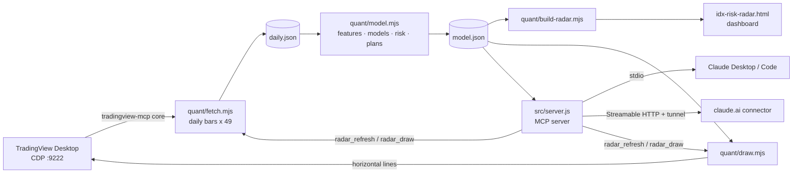

# Architecture

## 1. Data (`quant/fetch.mjs`)

For IHSG and each of 48 stocks: set the chart symbol, wait until the bar series changes, read up to 500 daily bars through the chart's internal series. The chart's original symbol and timeframe are restored at the end.

## 2. Features (`quant/model.mjs`)

All series are aligned on the IHSG trading calendar. For each stock and day (after a 100-day warm-up), 26 features:

| Group | Features |
|---|---|
| Momentum | 5, 20, 60-day log return; 100-day return skipping the last 5 days |
| Relative strength | 20 and 60-day return minus IHSG |
| Trend | distance from 20, 50, 100-day averages; RSI 14; Bollinger %B |
| Volatility | ATR %, 20 and 60-day volatility, their ratio, EWMA volatility (λ = 0.94) |
| Path / tails | drawdown from 60-day high, rise from 60-day low, skewness, downside deviation, 5-day variance ratio |
| Market link | 60-day beta, correlation and residual (stock-specific) volatility vs IHSG |
| Liquidity | log 20-day traded value, 5/20-day volume ratio |

Each feature is converted to a **cross-sectional rank** in [-0.5, 0.5] per day, which removes market-wide moves and outliers.

Target: cross-sectional rank of the next 20-day log return.

## 3. Models

| Model | Detail |
|---|---|
| Ridge regression | closed form, λ = 5 |
| Logistic regression | above/below median, L2, batch gradient descent |
| Gradient-boosted trees | 120 trees, depth 3, learning rate 0.05, 70% row subsample, min leaf 40 |
| Neural network | 26 → 16 → 8 → 1, ReLU, Adam, 40 epochs, L2 1e-4 |
| Factor rule | equal-weight momentum + relative strength + trend − volatility − downside risk (no fitting) |

All are implemented in plain JavaScript with a fixed seed, so runs are reproducible.

## 4. Validation

Walk-forward: train on all dates before `t − 20`, test on `t … t+19`, step 20 days. The 20-day purge stops overlapping labels leaking future returns into training.

Per model: mean daily rank IC (Spearman), share of days with IC > 0, t-statistic on non-overlapping days, top-minus-bottom quintile 20-day return.

**Ensemble weights** = each model's positive out-of-sample IC, normalised; models with IC ≤ 0 get 0. Because weights are chosen on the same test window, the ensemble's reported IC is optimistic.

**Reliability flag**: `reliable = true` only when the ensemble IC is positive with t ≥ 2 over at least 8 independent periods. The dashboard and the MCP tools report this flag.

## 5. Risk and labels

- **Risk grade A–E**: average cross-sectional percentile of 60-day volatility, CVaR 95%, max drawdown, beta, illiquidity and excess kurtosis, cut into fifths.
- **Shortlist**: score ≥ 70, grade A–C, ≥ Rp10 bn traded per day, stop/target expectancy > −0.1R over the past year.
- **Avoid**: score ≤ 30, grade E, or < Rp10 bn traded per day. Everything else is **Watch**.

## 6. Trade levels

| Level | Rule |
|---|---|
| Entry | last close |
| Stop loss | entry − 1.5 × ATR(14), rounded **down** to the IDX tick |
| Take profit 1 / 2 | entry + 1.5R / 2.5R, rounded to nearest tick |
| BEP | entry × (1 + 0.15%) / (1 − 0.25%), rounded **up** (sell fee includes 0.1% final tax) |
| Support / resistance | swing highs/lows (5 bars each side) clustered within 0.5 ATR |

IDX ticks: < 200 → 1, < 500 → 2, < 2,000 → 5, < 5,000 → 10, else 25. Lots are 100 shares.

Bracket statistics: from every past close, does take profit 1 come before the stop within 20 bars? Same-bar touches count as a loss.

## 7. Market regime

Four warning signs for IHSG: below its 50-day average, below its 100-day average, 20-day volatility above the full-sample level, more than half the universe in a downtrend. 0 = Calm … 4 = High caution.

## 8. Allocation

Long-only minimum-variance weights over the shortlist from 120 days of returns, projected gradient descent, capped at 35% per stock. Reports portfolio volatility, average stock volatility and average correlation.

## 9. Chart drawing (`quant/draw.mjs`)

For each stock: switch the chart, delete horizontal lines whose label this tool wrote (labels starting `RADAR`), then draw entry, BEP, stop, two take profits and support/resistance. TradingView stores drawings per symbol, so each chart keeps its own lines. Your own drawings are never touched.

## 10. MCP server (`src/server.js`)

`@modelcontextprotocol/sdk`, five tools. stdio by default. `--http` serves stateless Streamable HTTP on `127.0.0.1:$PORT` at `/mcp/$RADAR_TOKEN`; control tools are added only when `RADAR_ALLOW_CONTROL=1`. Long steps run as child processes from the repo root.
