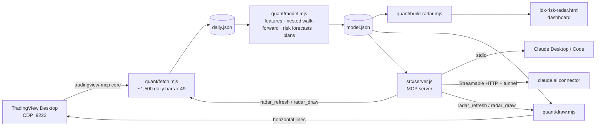

# Architecture

## 1. Data (`quant/fetch.mjs`)

For IHSG and each of 48 stocks: set the chart symbol, wait until the bar series changes, then call the main series' `requestMoreData` until it holds `RADAR_BARS` (default 1,500) bars or stops growing, and read every bar. TradingView back-adjusts for splits. The chart's original symbol and timeframe are restored at the end.

Stocks listed after the start (MTEL, GOTO, AMMN) enter once they have 100 days of history. Suspension days after listing are forward-filled with zero volume.

## 2. Features (`quant/model.mjs`)

All series are aligned on the IHSG calendar. For each stock and day (after a 100-day warm-up):

| Group | Features |
|---|---|
| Momentum | 5, 20, 60-day log return; 100-day return skipping the last 5 days |
| Relative strength | 20 and 60-day return minus IHSG |
| Trend | distance from 20, 50, 100-day averages; RSI 14; Bollinger %B |
| Volatility | ATR %, 20 and 60-day volatility, their ratio, EWMA volatility (λ = 0.94) |
| Path / tails | drawdown from 60-day high, rise from 60-day low, skewness, downside deviation, 5-day variance ratio |
| Market link | 60-day beta, correlation and residual volatility vs IHSG |
| Liquidity | log 20-day traded value, 5/20-day volume ratio |
| Market state (risk models only) | log IHSG EWMA volatility, IHSG 20-day return, IHSG below its 1-year high, breadth (share above 50-day average) |

- **Return model:** features are cross-sectional ranks in [-0.5, 0.5] per day.
- **Risk models:** volatility-type features are logged, then z-scored on the training window and clipped at ±4. Logs keep crash-level values close to the training range.

## 3. Targets (next 20 trading days)

| Target | Type | Definition |
|---|---|---|
| `ret` | rank | cross-sectional rank of the 20-day log return |
| `stop` | yes/no | low touches entry − 1.5 × ATR(14) |
| `crash` | yes/no | low falls 10% or more below today's close |
| `vol` | regression | log of realised daily volatility |
| `mae` | regression | worst low ÷ today's close − 1 |

## 4. Learning without overfitting

1. **More data:** about 6 years and 65k stock-days.
2. **Thinning:** training uses every 5th day. Adjacent 20-day labels overlap by 19 days, so keeping them all would let models memorise near-duplicates.
3. **Strong baseline:** for each risk target, a small regularised model on four inputs (the stock's log EWMA volatility, ATR %, IHSG volatility, IHSG distance from its 1-year high). Learners fit **residuals** on top of it (regression) or start from its **logits** (classification).
4. **Three learners per target:**
   - Ridge / logistic: penalty chosen on validation from a grid.
   - Histogram gradient boosting: depth 2, 200-row minimum leaves, L2 = 5 on leaves, 50% row and 60% column subsampling, learning rate 0.03, **early stopping** with a patience of 40 trees.
   - Neural net: k-8-1 ReLU, L2 = 1e-3, **early stopping** with a patience of 3, bagged over 2 seeds.
5. **Nested walk-forward:**
   - Outer loop: train on everything before `t − 20` (purge), test on the next 60 days, roll forward. That gives 17 blocks after a 400-day minimum.
   - Inner loop: within each training window, the last 15% (after its own purge) is validation for hyperparameters, early stopping, ensemble weights and Platt calibration.
6. **Model selection on evidence:** ensemble weights are the learners' positive validation skill. On the final fit, a risk target falls back to the baseline when its learners did not beat the baseline out of sample (AUC for yes/no targets, MSE skill for regression).
7. **Calibration:** the chosen predictor's yes/no probabilities are recalibrated (Platt scaling) on all pooled out-of-sample predictions.
8. **Reported for every target:** skill on training rows vs unseen rows (the overfit gap), per-learner skill and weight, AUC / Brier / calibration table, or R².

Reliability flags: return ranking needs IC > 0 with t ≥ 2 over ≥ 8 independent periods. For risk targets, the chosen predictor needs AUC ≥ 0.6 (yes/no) or R² ≥ 0.25 (volatility) / 0.15 (dip). Only forecasts that pass feed the risk grade and labels.

### Results on the current data (2020-08 → 2026-11)

| Target | Chosen | Unseen-data result |
|---|---|---|
| Return rank | IC-weighted ensemble | IC −0.006, t −0.43 over 49 periods: **no edge** |
| 10%+ drop | baseline | AUC 0.618, well calibrated: **usable for ranking risk** |
| Volatility | baseline | R² 0.31: **usable for sizing** |
| Stop hit | baseline | AUC 0.48: not predictable per stock (the stop already scales with ATR); about 61% of stops are touched within 20 days |
| Worst dip | baseline | R² ≈ 0: shown only as a bad-case range |

On every risk target the boosted trees and neural net failed to beat the baseline out of sample. The selection step catches exactly that kind of overfitting.

## 5. Risk grade, labels and mitigation

- **Risk grade A–E:** weighted cross-sectional percentile of 60-day volatility, CVaR 95%, max drawdown, beta, illiquidity and excess kurtosis. Forecasts that passed testing are added: the 10%-drop chance (weight 2) and forecast volatility (weight 1). The result is cut into fifths.
- **Shortlist:** score ≥ 70, grade A–C, ≥ Rp10 bn traded per day, stop/target expectancy > −0.1R, and a 10%-drop forecast at or below the median.
- **Avoid:** score ≤ 30, grade E, < Rp10 bn traded per day, or a 10%-drop forecast in the riskiest tenth. Everything else is **Watch**.
- **Size multiplier:** median forecast volatility ÷ this stock's forecast volatility, clamped to 0.25–1.5. The calculator only scales size down.
- **Wider stop:** if entry × (1 + bad-case dip) is at or below the stop, the stop sits inside normal noise. The tool then suggests a wider stop just below the bad-case level, with fewer lots. The bad-case dip is the predicted dip plus the 10th percentile of out-of-sample errors.

## 6. Trade levels

| Level | Rule |
|---|---|
| Entry | last close |
| Stop loss | entry − 1.5 × ATR(14), rounded **down** to the IDX tick |
| Take profit 1 / 2 | entry + 1.5R / 2.5R, rounded to the nearest tick |
| BEP | entry × (1 + 0.15%) / (1 − 0.25%), rounded **up** (the sell fee includes the 0.1% final tax) |
| Support / resistance | swing highs/lows (5 bars each side) over the last 300 days, clustered within 0.5 ATR |

IDX ticks: < 200 → 1, < 500 → 2, < 2,000 → 5, < 5,000 → 10, else 25. Lots are 100 shares.

## 7. Market regime

Four warning signs for IHSG: below its 50-day average, below its 100-day average, 20-day volatility above its long-run level, more than half the universe in a downtrend. 0 = Calm … 4 = High caution.

## 8. Allocation

Long-only minimum-variance weights over the shortlist from 120 days of returns, projected gradient descent, capped at 35% per stock.

## 9. Chart drawing (`quant/draw.mjs`)

For each stock: switch the chart and delete horizontal lines whose label starts with `RADAR`. Then draw entry, BEP, stop (labelled with its historical touch rate), the wider stop when needed, two take profits, and support/resistance. TradingView stores drawings per symbol, so each chart keeps its own lines. Your own drawings are never touched.

## 10. MCP server (`src/server.js`)

`@modelcontextprotocol/sdk`, five tools. stdio by default. `--http` serves stateless Streamable HTTP on `127.0.0.1:$PORT` at `/mcp/$RADAR_TOKEN`. Control tools are added only when `RADAR_ALLOW_CONTROL=1`. Long steps run as child processes from the repo root.

## 11. Integrated risk engine (`quant/risk.mjs`, shared numerics in `quant/lib.mjs`)

Combines quantitative-finance models with machine learning and compiles them into an assessment and mitigation plan per stock, plus a portfolio risk dataset. Every component is refitted on data before each test block: 9 walk-forward blocks of 120 days, Sep 2022 to Oct 2026, evaluated every 5th day.

| Component | Method | Output |
|---|---|---|
| Volatility | GARCH(1,1), Gaussian QMLE with variance targeting, Nelder-Mead | current and long-run vol, 1/5/10/20-day term structure, shock half-life |
| Path simulation | Filtered historical simulation: GARCH variance path × bootstrapped standardised (close, low, high) shocks from the stock's own history, 4,000 paths | P(stop touched), P(10% drop), P(take profit 1 before stop), 20-day return quantiles, ES 95%, noise-aware stop (35% touch level), realistic target (median 20-day high) |
| Tail risk | GPD on standardised losses above the 90th percentile (probability-weighted moments), scaled by GARCH σ (McNeil-Frey conditional EVT); Cornish-Fisher for comparison | 1-day VaR / ES 99%, tail shape ξ |
| Market regime | 2-state Gaussian HMM on IHSG returns (Baum-Welch, scaled forward-backward) | P(high-volatility regime), regime vols, expected duration |
| Liquidity | Corwin-Schultz high-low spread estimator, 20-day traded value | spread %, size limits |
| Market link | beta, downside beta (IHSG down days), residual volatility | stress losses |
| Volatility baseline | logistic regression on log EWMA vol, ATR %, IHSG vol, IHSG drawdown | P(10% drop) |
| Deep network | 86-32-16-8-1 ReLU, dropout 0.2, L2, Adam, early stopping; input = last 20 days of close/low/high moves scaled by the stock's EWMA vol, IHSG moves scaled by IHSG vol, plus 6 state variables | P(10% drop) |
| Integration | stacked logistic regression on the component outputs, trained only on earlier blocks | integrated P(10% drop), P(stop), driver attribution |

### Validation on unseen data (current run)

| Check | Result |
|---|---|
| 10%-drop AUC: Monte Carlo / baseline / deep net / **integrated** | 0.616 / 0.622 / 0.603 / **0.622** |
| Integrated Brier skill vs base rate | +6% (Monte Carlo alone has the lowest Brier, 0.2169) |
| Deep network AUC, training vs unseen | 0.67 vs 0.57: it overfits, and the stacked model gives it a small weight |
| Stop touched (1.5 ATR) | AUC 0.53: not predictable per stock; about 62% are touched within 20 days |
| 20-day volatility forecast correlation, GARCH vs EWMA | 0.41 vs 0.53: EWMA tracks this period better |
| Raw GARCH-EVT VaR 99% | breaks on 1.44% of days (Kupiec rejects); 11 of 48 stocks fail individually |
| Backtest-corrected VaR (×1.085 fitted on the first half, checked on the second) | breaks on 1.16% (Kupiec p = 0.016): better, still slightly optimistic; the final factor is ×1.12 |

### Assessment and mitigation (per stock)

- **Score:** percentile of the integrated 10%-drop probability across the universe. **Verdict:** Low / Moderate / Elevated / High / Severe by fifths (a relative ranking).
- **Size factor:** 1 / 0.8 / 0.6 / 0.4 / 0 by verdict, halved when the HMM puts IHSG in its high-volatility regime with ≥ 70% probability.
- **Actions (rule-based on the simulated numbers):**
  - Swap to the noise-aware stop with fewer lots when the planned stop's touch chance is above 50%.
  - Take partial profit at the realistic target when take profit 1 is reached first in fewer than 30% of paths.
  - Use limit orders when the spread is above 1%.
  - Pair with lower-beta names when downside beta is above 1.2.
  - Treat event dates with care when the tail shape ξ is above 0.25.
  - Reassess triggers: volatility, support break, regime change.
- **Stress tests per lot:** IHSG −10% / −20% (expected = downside beta × shock; bad = minus 1.645 × residual vol × √20), a replay of the worst 20-day IHSG window in the data, and simulated ES 95%.
- **Labels:** the integrated verdict can only make a label more cautious. Severe → Avoid; High removes a stock from the Shortlist.

### Portfolio lab

Ledoit-Wolf shrinkage (towards scaled identity) of the 250-day daily covariance. The browser and the `radar_portfolio` tool compute portfolio volatility, parametric VaR/ES (1 and 20 days), each holding's share of risk, the diversification benefit, the effective number of stocks, stress losses, sector concentration, and equal-weight / minimum-variance / risk-parity splits.

## 12. Web backend and collector (`src/web.js`, `src/core.js`, `quant/collect.mjs`, `quant/dashboard.mjs`)

- **Shared core** (`src/core.js`): data access with mtime caching (`RADAR_DATA_DIR`), the stocks table with integrated verdicts merged in, portfolio risk, the pipeline runner, and every MCP tool definition. Both servers use it, so the local stdio server and the web backend answer identically.
- **Web backend:**
  - Plain `node:http` with no web framework.
  - Token login that sets a 30-day HttpOnly, SameSite=Lax session cookie (an HMAC of the token, Secure behind HTTPS).
  - Bearer-token JSON API.
  - Stateless MCP over Streamable HTTP at `/mcp` (header token) or `/mcp/<token>` (for claude.ai).
  - Gzip uploads with an optional separate ingest token.
  - One background retrain job at a time.
  - Security headers (CSP, nosniff, frame-deny, no-referrer, no-store) and a per-IP login rate limit.
- **Dashboard rendering** (`quant/dashboard.mjs`): the same template as the static build, rendered from the latest JSON. Embedded data is escaped so it can't close the script tag.
- **Collector:**
  - On the TradingView PC: fetch, then train + risk engine locally (default), or upload raw bars for the server to retrain.
  - Optionally redraws the chart lines.
  - Uploads gzipped JSON over HTTPS.
- **Deployment:** `Dockerfile` (node:20-slim, non-root, healthcheck, `/data` volume), `fly.toml` (Singapore, volume), `render.yaml` (disk), `docker-compose.yml` (optional Cloudflare Tunnel). See DEPLOY.md.
- **Tests** (`test/web.test.js`): login, cookie, CSP, every API route, MCP with header and path tokens, upload auth and validation, gzip publish.
