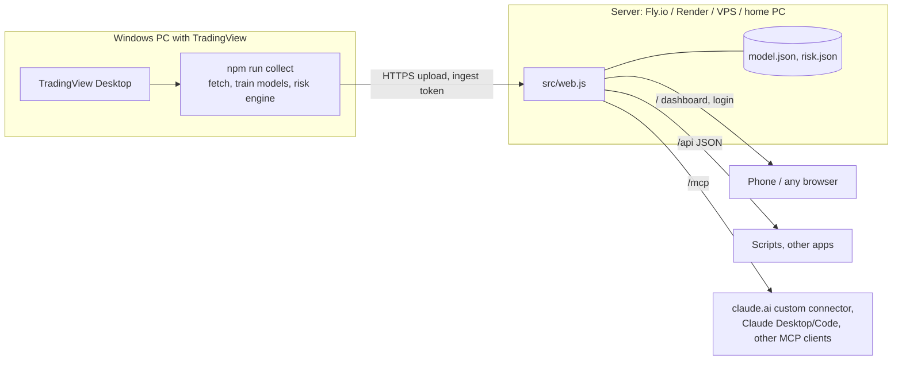

# Deploying IDX Risk Radar as a web backend

Run the radar on a server so you can open it from **any device** (phone, laptop, another PC), and connect **claude.ai** or any MCP client to it, without needing the Windows PC with Claude Desktop and TradingView.



- The **PC** is only needed to collect fresh data, for example once a day after the market closes. Everything else runs on the server.
- The **server** doesn't need TradingView, Windows or Claude.

## What the server provides

| Path | Who | What |
|---|---|---|
| `/` | browser, after login | the full dashboard (assessments, trade table, portfolio lab) |
| `/login`, `/logout` | browser | token login; a 30-day HttpOnly session cookie |
| `/api/market` | token | market weather, regime, shortlist, data freshness |
| `/api/stocks?label=&sector=&max_risk=&sort=&limit=` | token | entry / BEP / stop / take profit / integrated risk table |
| `/api/stocks/BBRI`, `/api/assess/BBRI` | token | one stock, its integrated assessment |
| `POST /api/portfolio` `{holdings:[{ticker,amount}]}` | token | VaR/ES, risk contributions, stress tests |
| `/api/validation`, `/api/status` | token | out-of-sample evidence; data freshness and retrain status |
| `/mcp` (header) or `/mcp/<token>` (path) | token | MCP over Streamable HTTP: 7 read tools + `radar_status` |
| `POST /api/publish`, `POST /api/ingest` | ingest token | uploads from the collector |
| `/healthz` | anyone | liveness (no data) |

Token means `Authorization: Bearer <RADAR_TOKEN>` (or the login cookie in a browser).

## 1. Choose where to run it

### Option A: Fly.io (Singapore region, close to IDX)

```bash
fly launch --no-deploy --copy-config
fly volumes create radar_data --size 1 --region sin
fly secrets set RADAR_TOKEN=<long random string>
fly deploy
```

Your URL is `https://<app-name>.fly.dev`. The machine stops when idle and starts again on the next request. The volume keeps the data.

### Option B: Render

Create a **Blueprint** from this repository; `render.yaml` is included. Render generates `RADAR_TOKEN` for you, and you can find it under *Environment*. The persistent disk needs a paid instance type. On the free type the data is lost whenever the service restarts, so the collector has to upload again.

### Option C: your own machine or a VPS, with Docker

```bash
echo RADAR_TOKEN=<long random string> > .env
docker compose up -d --build
```

The server listens on `127.0.0.1:8080`. To reach it from other devices without opening ports, use a **Cloudflare Tunnel**:
1. Create one in the Cloudflare dashboard (Zero Trust → Networks → Tunnels).
2. Point it at `http://radar:8080`.
3. Put its token in `.env` as `CLOUDFLARE_TUNNEL_TOKEN`.
4. Uncomment the `tunnel` service in `docker-compose.yml`.

### Option D: no Docker (any OS with Node 18+)

```bash
npm install
RADAR_TOKEN=<long random string> RADAR_DATA_DIR=./server-data npm run web
```

To make a long random token:

```bash
node -e "console.log(require('crypto').randomBytes(32).toString('base64url'))"
```

## 2. Set up the collector on the TradingView PC

In the `idx-risk-radar` folder on Windows (PowerShell):

```powershell
$env:RADAR_SERVER = "https://<your-server>"
$env:RADAR_INGEST_TOKEN = "<the same RADAR_TOKEN, or a separate RADAR_INGEST_TOKEN set on the server>"
npm run launch      # start TradingView with the debug port, if it is not running
npm run collect     # fetch -> train -> risk engine -> upload results
```

Variants:
- `npm run collect:draw` also redraws the levels on your TradingView charts.
- `npm run collect:server` uploads only the raw bars and lets the server retrain. This is slower on small servers, about 15–30 minutes on one shared CPU. Watch progress at `/api/status`.

To store the settings permanently, run `setx RADAR_SERVER "https://..."` and `setx RADAR_INGEST_TOKEN "..."` once, then open a new terminal.

**Daily refresh:** in Windows Task Scheduler, create a task that runs after the IDX close (for example 16:30 WIB, Monday to Friday):
- Program: `cmd.exe`
- Arguments: `/c cd /d "C:\path\to\idx-risk-radar" && npm run collect >> collect.log 2>&1`

TradingView must be open with its debug port at that time.

## 3. Open it from any device

Go to `https://<your-server>/`, enter the token once, and the session lasts 30 days. On a phone, use the browser's **Add to Home Screen** to get an app-like shortcut.

## 4. Connect Claude

**claude.ai (web, mobile, desktop): custom connector.**
1. Go to **Settings → Connectors → Add custom connector**.
2. Use the URL `https://<your-server>/mcp/<RADAR_TOKEN>`.

claude.ai can't send a custom header, so the token goes in the path. Treat that URL like a password.

**Claude Code** (any machine):

```bash
claude mcp add --transport http idx-radar https://<your-server>/mcp --header "Authorization: Bearer <RADAR_TOKEN>"
```

**Claude Desktop on the TradingView PC:** keep using the local stdio server (`src/server.js`). It has the extra `radar_refresh` and `radar_draw` tools that need TradingView.

## Security

- Use a long random token, and HTTPS: all the hosted options and Cloudflare Tunnel provide HTTPS.
- Give the collector its own `RADAR_INGEST_TOKEN` if you want read access and upload rights separated.
- The server only reads and serves your model output. It can't trade, and the web/MCP tools can't control TradingView.
- Logins are rate-limited per IP. Responses carry no-store caching and a strict Content-Security-Policy.
- This is a statistical screen of past prices, not investment advice.
